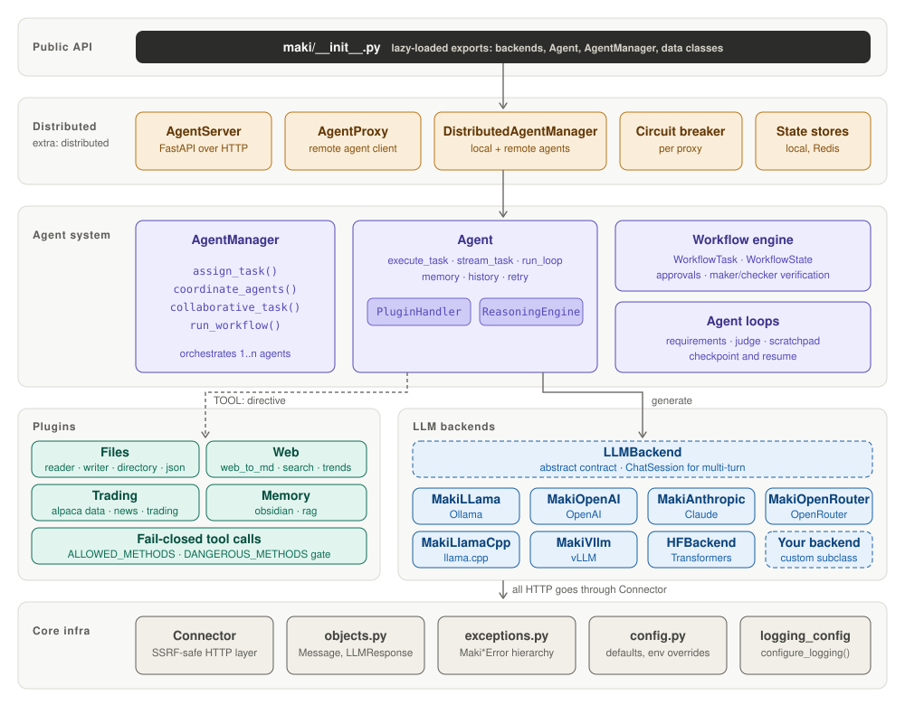

# Architecture



Four layers on top of a shared infrastructure layer:

- **Public API:** `maki/__init__.py` lazy-loads all exports on first access.
- **LLM backends:** `MakiLLama`, `MakiOpenAI`, `MakiAnthropic`, `MakiOpenRouter`, `MakiLlamaCpp`, `MakiVllm` and `HFBackend` all implement the abstract `LLMBackend` contract.
- **Agent system:** `Agent` composes `PluginHandler` and `ReasoningEngine` mixins; `AgentManager` orchestrates agents via `WorkflowTask` and `WorkflowState`. The loop engine (`maki/agents/loop.py`, with `loop_judge.py` and `loop_scratchpad.py`) iterates one agent until a separate judge, a command or a callable confirms every requirement; it also runs as a `WorkflowTask(loop=...)`. See [Agent loops](loops.md).
- **Distributed layer:** `AgentServer` (FastAPI) exposes agents over HTTP, and runs loops for remote callers in background jobs (`loop_jobs.py`); `AgentProxy` is the remote-agent client with circuit breaking and `run_loop()`; `DistributedAgentManager` mixes local and remote agents.
- **Infrastructure:** `Connector` (hardened HTTP: URL validation, connect-time IP pinning), shared data classes, typed exceptions, runtime config and logging.

Plugins sit alongside the agent layer. They are loaded on demand and invoked when the model emits a `TOOL:` directive or through native tool-calling APIs.

## Public API

Top-level imports from `maki`:

- `MakiLLama`, `MakiOpenAI`, `MakiAnthropic`, `MakiOpenRouter`, `MakiLlamaCpp`, `MakiVllm`, `HFBackend`
- `LLMBackend`, `BackendType`
- `Agent`, `AgentManager`
- `LoopSpec`, `Requirement` (the rest of the loop API lives in `maki.agents`)
- `GenerationConfig`, `LLMResponse`, `Message`, `ToolCall`
- `ConversationMemory`, `RateLimiter`
- `Connector`, `Utils`
- `config`

## Contributing

Bug fixes, documentation, new plugins and suggestions are welcome. Open an issue or pull request on [GitHub](https://github.com/BowlOfData/maki).

```bash
pip install -e ".[dev]"
pytest          # tests marked @pytest.mark.network are excluded by default
```

Maki is part of [Bowl of Data](https://bowlofdata.net/), an open-source AI research community. Licensed under [MIT](https://github.com/BowlOfData/maki/blob/main/LICENSE).
